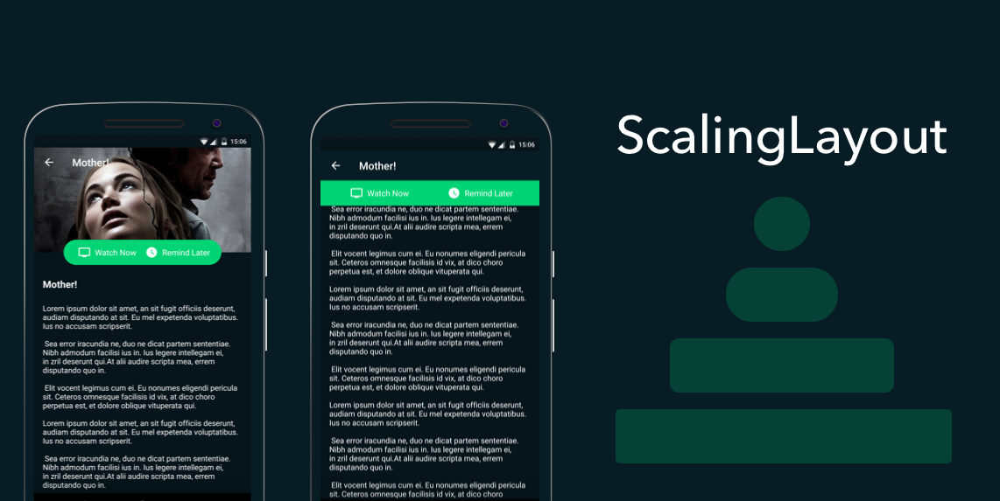

# ScalingLayout
[](https://github.com/iammert/ScalingLayout/actions/workflows/android.yml) [](https://jitpack.io/#iammert/ScalingLayout)

Scale your layout on user interaction. [Live Demo](https://www.youtube.com/watch?v=wA41H0UMoHQ)

Motivated by layout in [Blinkist](https://play.google.com/store/apps/details?id=com.blinkslabs.blinkist.android) app and search bar in [Spotify](https://play.google.com/store/apps/details?id=com.spotify.music) app.



## Demo


## Fab Demo


## Spotify Search Demo


## Usage
```xml
<iammert.com.view.scalinglib.ScalingLayout
        android:id="@+id/scalingLayout"
        android:layout_width="300dp"
        android:layout_height="48dp"
        app:radiusFactor="1"
        app:animationDuration="200">

        <!-- Your content here -->

</iammert.com.view.scalinglib.ScalingLayout>
```

```java
scalingLayout.expand(); // expands the layout to full width
scalingLayout.collapse(); // collapses the layout to its initial state
scalingLayout.expand(false); // expands without animation, same for collapse(false)
scalingLayout.toggle(); // collapses if expanded or expanding, expands otherwise
scalingLayout.isExpanded(); // true if fully expanded
scalingLayout.setProgress(float progress); // 1 is fully expanded, 0 is initial state
scalingLayout.getProgress(); // current progress between 0 and 1

scalingLayout.setAnimationDuration(300); // expand/collapse duration in milliseconds
scalingLayout.setInterpolator(new FastOutSlowInInterpolator());
```

The expanded/collapsed state is saved and restored automatically on configuration changes (give the layout an `android:id`).
Calls made before the first layout, for example from `onCreate`, are applied right after the layout is measured.

The layout expands to the width available inside its parent and supports RTL layouts with `layout_marginStart`/`layout_marginEnd`.

### Accessibility
ScalingLayout exposes expand and collapse actions to TalkBack and announces whether it is expanded or collapsed.

## Listener
Use `addListener`/`removeListener` to register multiple listeners. `setListener` replaces all registered listeners.
All callbacks have empty default implementations, so you only override the ones you need.

```java
scalingLayout.addListener(new ScalingLayoutListener() {
    @Override
    public void onCollapsed() {}

    @Override
    public void onExpanded() {}

    @Override
    public void onProgress(float progress) {} // 0 is collapsed, 1 is expanded
});
```

## Attributes
| Attribute | Format | Default | Description |
|---|---|---|---|
| `app:radiusFactor` | float | `1` | Between 0 and 1. 1 = fully rounded corners, 0 = no rounded corners. |
| `app:animationDuration` | integer | `200` | Expand/collapse animation duration in milliseconds. |
| `app:maxExpandedWidth` | dimension | none | Limits the expanded width, for example on tablets. Also `setMaxExpandedWidth(int)`. |

## ScalingLayoutBehavior


The behavior follows an `AppBarLayout` and uses the toolbar height of your theme (`?android:attr/actionBarSize`).

```xml
<iammert.com.view.scalinglib.ScalingLayout
        android:id="@+id/scalingLayout"
        android:layout_width="300dp"
        android:layout_height="48dp"
        app:radiusFactor="1"
        app:layout_behavior="iammert.com.view.scalinglib.ScalingLayoutBehavior">

        <!-- Your content here -->

</iammert.com.view.scalinglib.ScalingLayout>
```

## Download
Add JitPack to your repositories in `settings.gradle`:

```gradle
dependencyResolutionManagement {
    repositories {
        google()
        mavenCentral()
        maven { url 'https://jitpack.io' }
    }
}
```

Add the dependency:

```gradle
dependencies {
    implementation 'com.github.iammert:ScalingLayout:2.2.0'
}
```

Requires minSdk 21 and AndroidX. Use `1.2.1` if your project still uses the Android Support Library.

### Migrating from 1.x
- The library now depends on AndroidX and Material Components instead of the Support Library.
- `ScalingLayoutListener.onProgress` now reports 0 for collapsed and 1 for expanded, the same scale as `setProgress`. Use `1 - progress` if you relied on the old value.

See [CHANGELOG.md](CHANGELOG.md) for all changes.

<a href='https://ko-fi.com/P5P872LP' target='_blank'></a>

License
--------


    Copyright 2017 Mert Şimşek.

    Licensed under the Apache License, Version 2.0 (the "License");
    you may not use this file except in compliance with the License.
    You may obtain a copy of the License at

       http://www.apache.org/licenses/LICENSE-2.0

    Unless required by applicable law or agreed to in writing, software
    distributed under the License is distributed on an "AS IS" BASIS,
    WITHOUT WARRANTIES OR CONDITIONS OF ANY KIND, either express or implied.
    See the License for the specific language governing permissions and
    limitations under the License.
